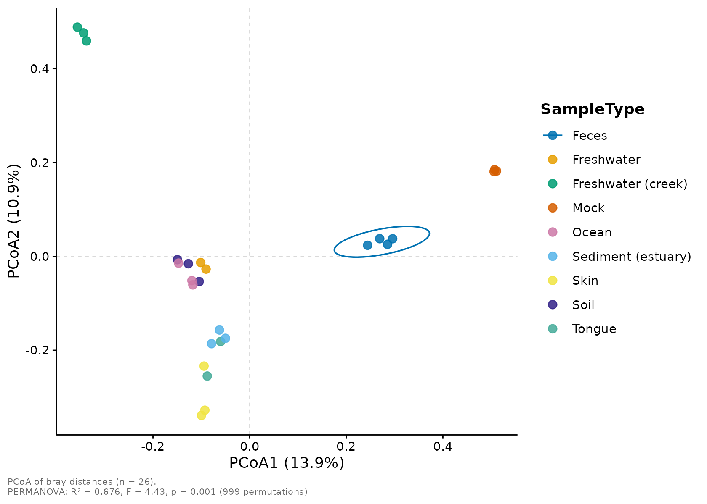
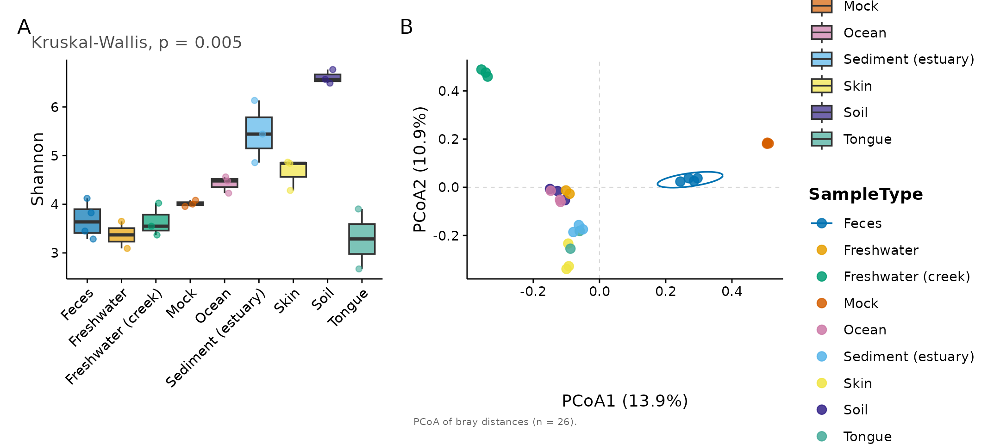
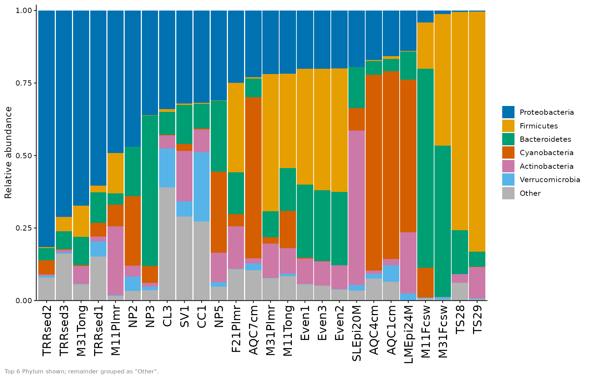

# Getting started with micropubr

`micropubr` turns a `phyloseq` object into a publication-ready figure
with a single, consistent call. Every function returns a `ggplot2`
object, so you can always extend the result with `+`.

``` r

library(micropubr)
#> micropubr 0.3.0 — publication-ready microbiome figures.
#> See `vignette("getting-started", package = "micropubr")` to begin.
data(GlobalPatterns, package = "phyloseq")

# Work with a lightly filtered subset for speed.
gp <- phyloseq::prune_taxa(
  phyloseq::taxa_sums(GlobalPatterns) > 5, GlobalPatterns)
```

## Alpha diversity

[`mp_alpha()`](https://daniilidisk.github.io/micropubr/reference/mp_alpha.md)
computes within-sample diversity and, when a grouping variable is
supplied, adds the appropriate statistical test automatically.

``` r

mp_alpha(gp, measure = c("Shannon", "Observed"),
         group.by = "SampleType", test = "kruskal")
#> Warning: Group(s) Feces (n = 4), Freshwater (n = 2), Freshwater (creek) (n =
#> 3), Mock (n = 3), Ocean (n = 3), Sediment (estuary) (n = 3), Skin (n = 3), Soil
#> (n = 3), Tongue (n = 2) have fewer than 5 samples; group comparisons have
#> little power and their p-values are unstable at this size.
#> Warning: Sequencing depth varies 40-fold across samples; richness (Observed)
#> depends strongly on depth, so consider rarefying or comparing at equal
#> coverage.
```


Switch to violins, or draw rarefaction curves, with `plot.type`:

``` r

mp_alpha(gp, plot.type = "rarefaction", group.by = "SampleType")
```


## Beta diversity

[`mp_ordination()`](https://daniilidisk.github.io/micropubr/reference/mp_ordination.md)
computes the distance, runs the ordination, draws group ellipses, and
reports a PERMANOVA in the caption — all by default.

``` r

mp_ordination(gp, method = "PCoA", distance = "bray", group.by = "SampleType")
#> Warning: Group(s) Feces (n = 4), Freshwater (n = 2), Freshwater (creek) (n =
#> 3), Mock (n = 3), Ocean (n = 3), Sediment (estuary) (n = 3), Skin (n = 3), Soil
#> (n = 3), Tongue (n = 2) have fewer than 5 samples; group comparisons have
#> little power and their p-values are unstable at this size.
#> Warning: Group dispersions differ (PERMDISP p = 0.002); a significant PERMANOVA
#> may reflect differences in spread rather than in location (centroids).
```



The compositional (Aitchison) workflow is one argument away:

``` r

mp_ordination(gp, method = "PCA", group.by = "SampleType")
```


## Taxonomic composition

[`mp_taxa()`](https://daniilidisk.github.io/micropubr/reference/mp_taxa.md)
shows the top taxa at any rank and collapses the rest into “Other”.

``` r

mp_taxa(gp, tax.level = "Phylum", group.by = "SampleType", top.n = 8)
```


## Differential abundance

[`mp_diff()`](https://daniilidisk.github.io/micropubr/reference/mp_diff.md)
visualises results from `DESeq2`, `ALDEx2`, `ANCOM-BC` or any generic
data frame. Here is a volcano plot from a generic table:

``` r

set.seed(1)
res <- data.frame(
  feature = paste0("ASV", 1:200),
  log2FC  = rnorm(200, 0, 2),
  pvalue  = runif(200)^2
)
res$log2FC[1:20] <- rnorm(20, 4, 0.5) * sample(c(-1, 1), 20, TRUE)
res$pvalue[1:20] <- runif(20, 1e-9, 1e-4)
res$padj <- p.adjust(res$pvalue, "BH")

mp_diff(res, plot.type = "volcano", label.top = 8)
```


## Composing and exporting figures

Combine panels into a labelled multi-panel figure and export it at a
journal column width.

``` r

fig <- mp_combine(
  mp_alpha(gp, measure = "Shannon", group.by = "SampleType"),
  mp_ordination(gp, group.by = "SampleType", permanova = FALSE),
  ncol = 2, tag.levels = "A"
)
#> Warning: Group(s) Feces (n = 4), Freshwater (n = 2), Freshwater (creek) (n =
#> 3), Mock (n = 3), Ocean (n = 3), Sediment (estuary) (n = 3), Skin (n = 3), Soil
#> (n = 3), Tongue (n = 2) have fewer than 5 samples; group comparisons have
#> little power and their p-values are unstable at this size.
fig
```



``` r

mp_export(fig, "figure1.pdf", column = "double", dpi = 600)
```

## Theming and palettes

All functions accept a `theme` and `palette` argument. The defaults are
colourblind-safe, but you can swap them freely:

``` r

mp_taxa(gp, tax.level = "Phylum", top.n = 6,
        palette = "taxa20", theme = mp_theme_nature())
```



See
[`?mp_palette`](https://daniilidisk.github.io/micropubr/reference/mp_palette.md)
and the `mp_theme_*()` family for the full set.

## Interactive plots

Add `interactive = TRUE` to any plotting function to get a live
[`plotly`](https://plotly.com/r/) widget instead of a static `ggplot` —
hover for tooltips, zoom, and toggle groups via the legend. The figure
below is interactive when the `plotly` package is installed:

``` r

mp_ordination(gp, method = "PCoA", distance = "bray",
              group.by = "SampleType", interactive = TRUE)
#> Warning: Group(s) Feces (n = 4), Freshwater (n = 2), Freshwater (creek) (n =
#> 3), Mock (n = 3), Ocean (n = 3), Sediment (estuary) (n = 3), Skin (n = 3), Soil
#> (n = 3), Tongue (n = 2) have fewer than 5 samples; group comparisons have
#> little power and their p-values are unstable at this size.
#> Warning: Group dispersions differ (PERMDISP p = 0.002); a significant PERMANOVA
#> may reflect differences in spread rather than in location (centroids).
```

Interactive figures save to a self-contained web page via the same
[`mp_export()`](https://daniilidisk.github.io/micropubr/reference/mp_export.md),
using an `.html` filename:

``` r

w <- mp_alpha(gp, measure = "Shannon", group.by = "SampleType",
              interactive = TRUE)
mp_export(w, "alpha.html")
```

The [visualization
gallery](https://daniilidisk.github.io/micropubr/articles/visualization.md)
vignette has more interactive examples. Note that `plotly` cannot
reproduce a few static-only overlays (such as significance brackets),
and the circular
[`mp_chord()`](https://daniilidisk.github.io/micropubr/reference/mp_chord.md)
/
[`mp_circos()`](https://daniilidisk.github.io/micropubr/reference/mp_circos.md)
figures have no interactive mode.
