# Statistics, machine learning and genomics

This vignette covers the **statistical**, **machine-learning** and
**genomics** functions. Like the plotting family, the statistical and ML
functions return a `ggplot` by default and a tidy data frame (with the
fitted model attached as an attribute) when `return.data = TRUE`. For
the figure functions see
[`vignette("visualization", package = "micropubr")`](https://daniilidisk.github.io/micropubr/articles/visualization.md).

``` r

library(micropubr)
data(GlobalPatterns, package = "phyloseq")
gp <- phyloseq::prune_taxa(
  phyloseq::taxa_sums(GlobalPatterns) > 5, GlobalPatterns)

# GlobalPatterns has no numeric covariates; add a few synthetic ones so the
# Mantel and variance-partitioning examples have something to chew on.
set.seed(1)
meta <- data.frame(phyloseq::sample_data(gp))
meta$pH    <- round(runif(nrow(meta), 5, 8), 1)
meta$Temp  <- round(runif(nrow(meta), 4, 37), 1)
meta$Depth <- round(runif(nrow(meta), 0, 100), 1)
phyloseq::sample_data(gp) <- phyloseq::sample_data(meta)
```

## Multivariate dispersion (PERMDISP)

[`mp_dispersion()`](https://daniilidisk.github.io/micropubr/reference/mp_dispersion.md)
tests whether group dispersions (spread around the centroid) differ, the
assumption behind PERMANOVA. Add ANOSIM/MRPP/PERMANOVA to the caption
with `add.test`.

``` r

mp_dispersion(gp, group.by = "SampleType", add.test = "permanova")
```

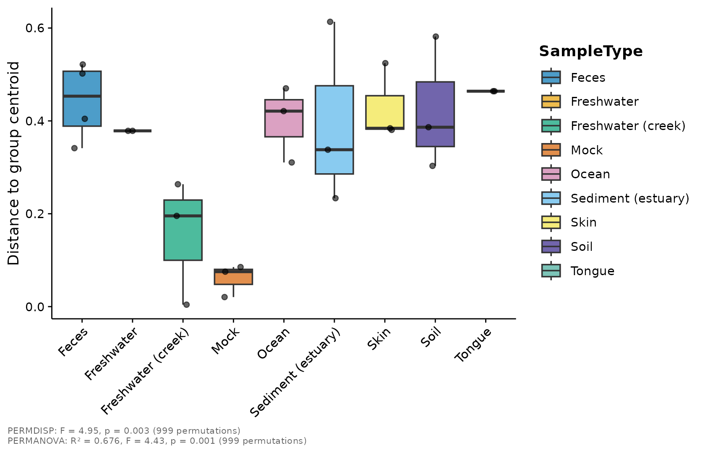

## Mantel test

[`mp_mantel()`](https://daniilidisk.github.io/micropubr/reference/mp_mantel.md)
correlates the community distance matrix with a distance built from
numeric metadata.

``` r

mp_mantel(gp, vars = c("pH", "Temp", "Depth"), method = "spearman")
```

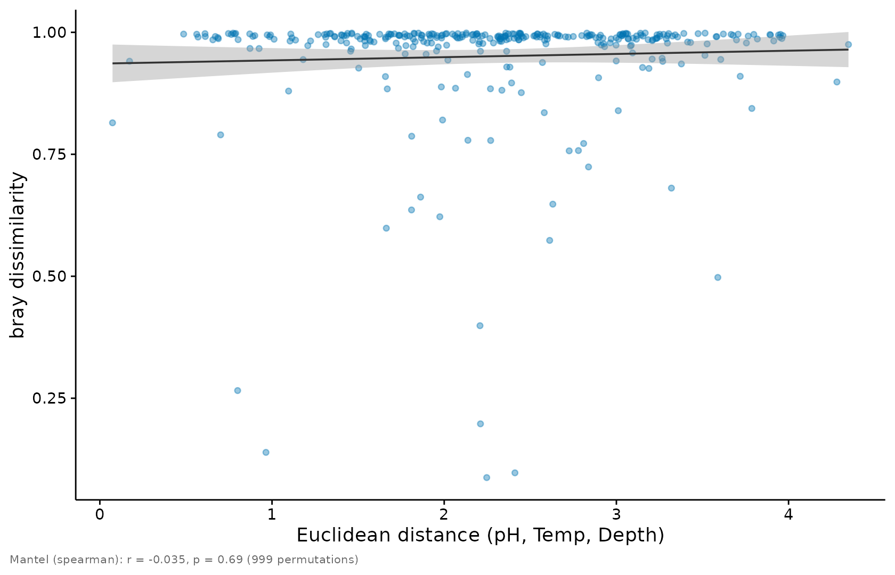

## Variance partitioning

[`mp_varpart()`](https://daniilidisk.github.io/micropubr/reference/mp_varpart.md)
partitions community variation among two or three explanatory sets (each
a vector of metadata columns).

``` r

mp_varpart(gp, groups = list(
  Chemistry = c("pH", "Temp"),
  Habitat   = "SampleType"))
```

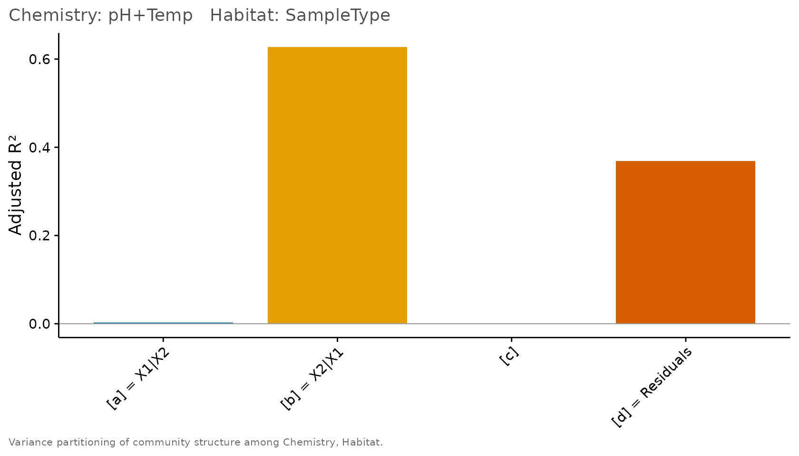

## Prevalence and the core microbiome

[`mp_prevalence()`](https://daniilidisk.github.io/micropubr/reference/mp_prevalence.md)
draws a prevalence-abundance scatter (`"scatter"`) or a core-microbiome
heatmap across detection thresholds (`"core"`). The core taxa are
labelled automatically; pass `color.by` to colour points by a taxonomic
rank when it has only a handful of levels (colouring by `"Phylum"` here
would add a 60-entry legend, so we leave it off).

``` r

mp_prevalence(gp, tax.level = "Phylum")
```

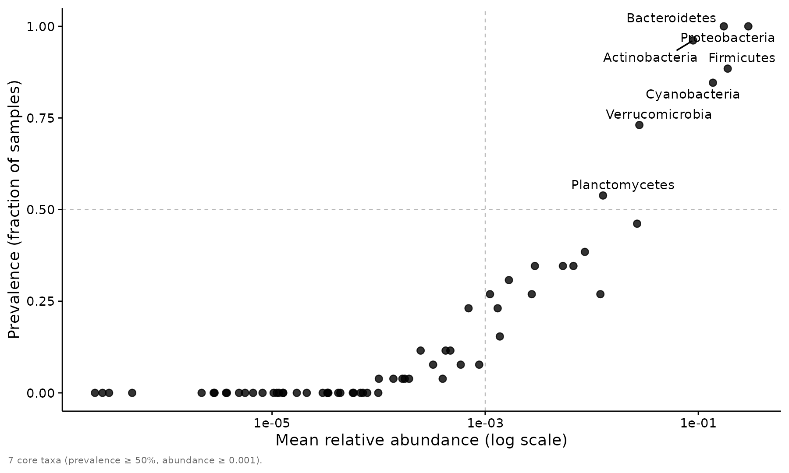

``` r

mp_prevalence(gp, tax.level = "Phylum", plot.type = "core")
```

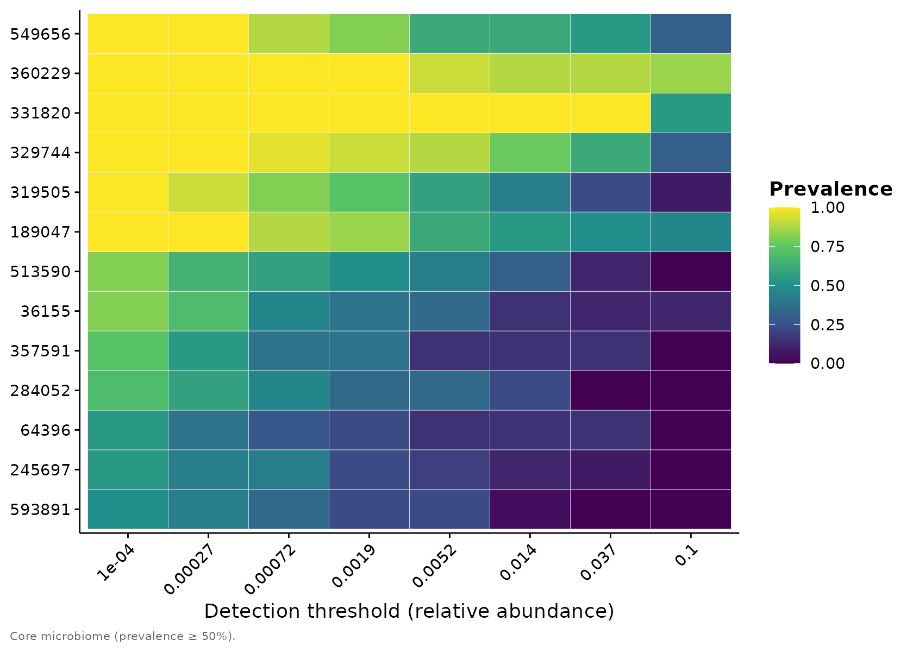

## Indicator species

[`mp_indicator()`](https://daniilidisk.github.io/micropubr/reference/mp_indicator.md)
finds taxa significantly associated with groups (via `indicspecies`).
(Requires the `indicspecies` package.)

``` r

mp_indicator(gp, group.by = "SampleType", tax.level = "Genus", top.n = 15)
```

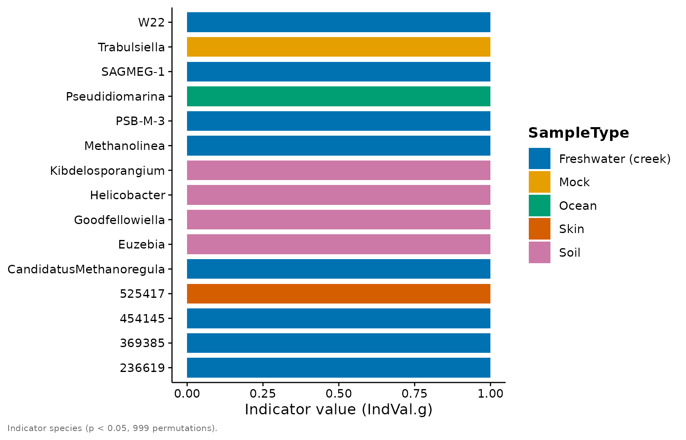

## Differential abundance end to end

[`mp_run_da()`](https://daniilidisk.github.io/micropubr/reference/mp_run_da.md)
tests every taxon for a difference between groups and returns a tidy
table that
[`mp_diff()`](https://daniilidisk.github.io/micropubr/reference/mp_diff.md)
plots. The default `"wilcox"` method (Wilcoxon on centred log-ratios)
needs no extra packages.

``` r

da <- mp_run_da(gp, group.by = "SampleType",
                method = "wilcox", groups = c("Feces", "Soil"),
                tax.level = "Genus")
mp_diff(da, plot.type = "volcano", label.top = 8)
```

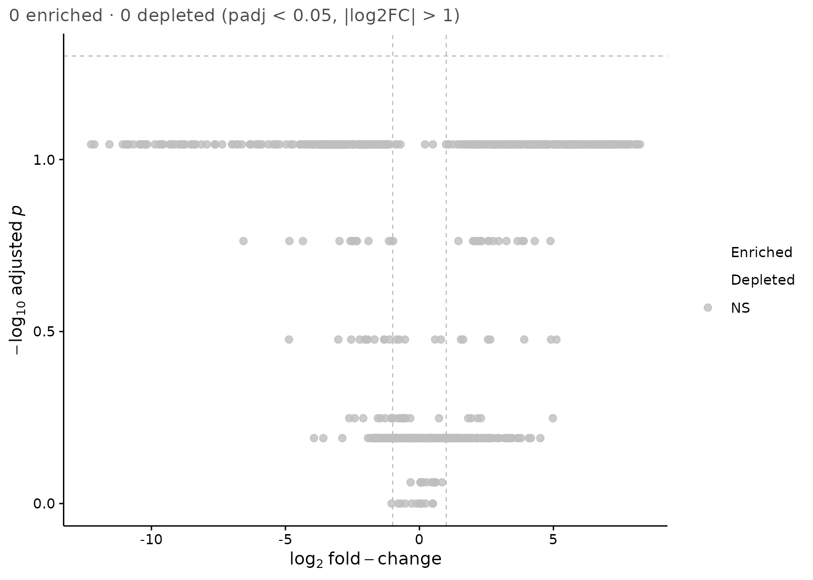

### Several groups, several methods

Leave out `groups` and every level is compared with a `reference` (or
every pair, with `pairwise = TRUE`). Methods are known to disagree, so
run more than one on the same design and look at where they agree.
`"lm"` fits a linear model to the CLR values and, unlike the Wilcoxon
test, can adjust for covariates (`adjust`) and model repeated measures
(`random`).

``` r

three <- phyloseq::subset_samples(gp, SampleType %in% c("Feces", "Skin", "Tongue"))
da3 <- mp_run_da(three, group.by = "SampleType", reference = "Skin",
                 method = c("wilcox", "lm"), adjust = "pH",
                 tax.level = "Phylum")
head(da3)
#>          feature feature_id      contrast method     log2FC     lfcSE
#> 1  Crenarchaeota      71074 Feces vs Skin wilcox -2.3507443 0.9237758
#> 2  Euryarchaeota     227785 Feces vs Skin wilcox  6.2822013 1.7906394
#> 3 Actinobacteria     326977 Feces vs Skin wilcox -1.7588608 1.7082346
#> 4   Spirochaetes      38741 Feces vs Skin wilcox -6.1383758 1.8529022
#> 5        SBR1093     203274 Feces vs Skin wilcox  0.8904921 0.3316668
#> 6   Fusobacteria      64396 Feces vs Skin wilcox -7.8187907 1.5586401
#>       pvalue      padj         mean robust structural_zero
#> 1 0.11428571 0.1714286 1.216788e-04     NA           FALSE
#> 2 0.05714286 0.1285714 3.960411e-04     NA           FALSE
#> 3 0.62857143 0.6578073 8.802244e-02     NA           FALSE
#> 4 0.05714286 0.1285714 1.088199e-03     NA           FALSE
#> 5 0.05714286 0.1285714 4.860320e-07     NA           FALSE
#> 6 0.05714286 0.1285714 3.378054e-02     NA           FALSE
mp_diff(da3, plot.type = "heatmap")
```

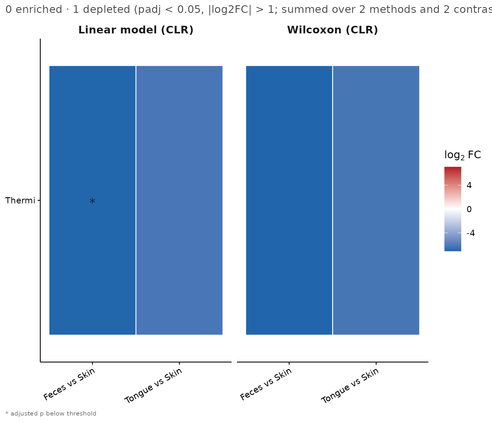

``` r

mp_diff(da3, plot.type = "consensus", fc.threshold = 0.5)
```

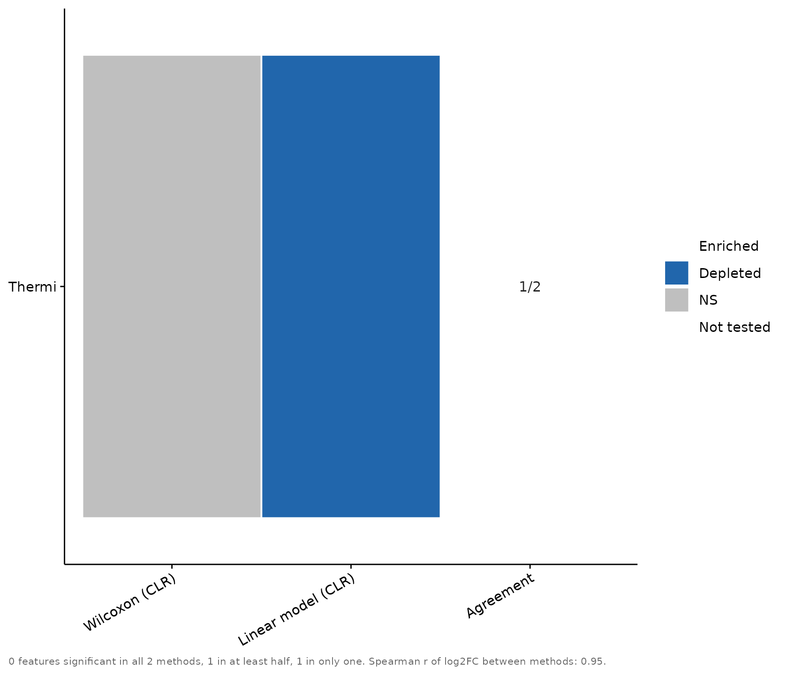

The consensus table behind the figure is available too:

``` r

head(mp_diff(da3, plot.type = "consensus", return.data = TRUE))
#>         feature feature_id       contrast n_methods n_significant n_enriched
#> 1        Thermi     380491  Feces vs Skin         2             1          0
#> 2  Fusobacteria      64396  Feces vs Skin         2             0          0
#> 3   Tenericutes     357591  Feces vs Skin         2             0          0
#> 4 Euryarchaeota     227785  Feces vs Skin         2             0          0
#> 5  Spirochaetes      38741  Feces vs Skin         2             0          0
#> 6        Thermi     380491 Tongue vs Skin         2             0          0
#>   n_depleted mean_log2FC consensus agreement
#> 1          1   -7.043335  Depleted       0.5
#> 2          0   -7.633077        NS       0.0
#> 3          0    6.891882        NS       0.0
#> 4          0    6.384392        NS       0.0
#> 5          0   -6.376219        NS       0.0
#> 6          0   -6.248846        NS       0.0
```

`"ancombc2"` (ANCOM-BC2, which corrects for sample-specific sampling
fractions), `"deseq2"` and `"aldex2"` wrap the respective Bioconductor
packages when they are installed. ANCOM-BC2 also reports taxa that are
structurally absent from a group (`plot.type = "zeros"`) and whether
each result survives its pseudo-count sensitivity analysis (the `robust`
column; non-robust results are drawn as open symbols).

``` r

da_bc <- mp_run_da(three, group.by = "SampleType", reference = "Skin",
                   method = c("lm", "ancombc2"), tax.level = "Phylum")
mp_diff(da_bc, plot.type = "zeros")
```

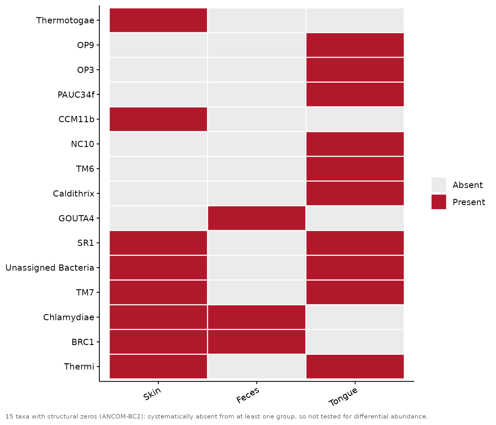

## Methods text and statistical guardrails

Every figure records the analysis behind it.
[`mp_methods()`](https://daniilidisk.github.io/micropubr/reference/mp_methods.md)
turns those records into a methods paragraph with software versions and
references, and lists any statistical caveats raised while the figures
were made – here, that the groups are small:

``` r

p_alpha <- mp_alpha(gp, measure = "Shannon", group.by = "SampleType",
                    test = "kruskal")
p_diff <- mp_diff(da3, plot.type = "heatmap")
mp_methods(p_alpha, p_diff)
#> Alpha diversity (Shannon) was estimated for 26 samples with phyloseq (McMurdie
#>   and Holmes 2013). Differences among the 9 SampleType groups (Feces, n = 4;
#>   Freshwater, n = 2; Freshwater (creek), n = 3; Mock, n = 3; Ocean, n = 3;
#>   Sediment (estuary), n = 3; Skin, n = 3; Soil, n = 3; Tongue, n = 2) were
#>   tested with the Kruskal-Wallis test (Kruskal and Wallis 1952), followed by
#>   pairwise Dunn's tests (Dunn 1964) adjusted with the Benjamini-Hochberg
#>   procedure (Benjamini and Hochberg 1995) (rstatix; Kassambara 2026).
#>   Differential abundance among SampleType groups (Skin, n = 3; Feces, n = 4;
#>   Tongue, n = 2) was tested for the contrasts Feces vs Skin and Tongue vs Skin
#>   on taxa agglomerated at the Phylum level detected in at least 10% of samples
#>   (45 taxa) using Wilcoxon rank-sum tests (Wilcoxon 1945) on centred log-ratio
#>   (CLR)-transformed counts (pseudocount 1; Aitchison 1986) and linear models on
#>   CLR-transformed counts (Aitchison 1986). Models were adjusted for pH; the
#>   Wilcoxon test cannot include covariates and was run unadjusted. P-values were
#>   adjusted within each method and contrast with the Benjamini-Hochberg
#>   procedure (Benjamini and Hochberg 1995); features with an adjusted p-value
#>   below 0.05 and an absolute log2 fold change above 1 were considered
#>   differentially abundant. Figures were produced in R 4.6.1 (R Core Team 2026)
#>   with micropubr 0.3.0 (Daniilidis 2026) and ggplot2 4.0.3 (Wickham 2016), with
#>   phyloseq 1.56.0 and rstatix 1.1.0.
#> 
#> References
#> Aitchison J (1986). The Statistical Analysis of Compositional Data. Chapman and
#>   Hall, London.
#> Benjamini Y, Hochberg Y (1995). Controlling the false discovery rate: a
#>   practical and powerful approach to multiple testing. Journal of the Royal
#>   Statistical Society Series B 57: 289-300.
#> Daniilidis K (2026). micropubr: a unified grammar for publication-ready
#>   microbiome visualization in R. R package version 0.3.0.
#>   https://github.com/daniilidisK/micropubr
#> Dunn OJ (1964). Multiple comparisons using rank sums. Technometrics 6: 241-252.
#> Kassambara A (2026). rstatix: Pipe-Friendly Framework for Basic Statistical
#>   Tests. R package version 1.1.0.
#> Kruskal WH, Wallis WA (1952). Use of ranks in one-criterion variance analysis.
#>   Journal of the American Statistical Association 47: 583-621.
#> McMurdie PJ, Holmes S (2013). phyloseq: an R package for reproducible
#>   interactive analysis and graphics of microbiome census data. PLoS ONE 8:
#>   e61217.
#> R Core Team (2026). R: A Language and Environment for Statistical Computing. R
#>   Foundation for Statistical Computing, Vienna, Austria.
#> Wickham H (2016). ggplot2: Elegant Graphics for Data Analysis. Springer-Verlag,
#>   New York.
#> Wilcoxon F (1945). Individual comparisons by ranking methods. Biometrics
#>   Bulletin 1: 80-83.
#> 
#> Statistical notes
#> * Group(s) Feces (n = 4), Freshwater (n = 2), Freshwater (creek) (n = 3), Mock
#>   (n = 3), Ocean (n = 3), Sediment (estuary) (n = 3), Skin (n = 3), Soil (n =
#>   3), Tongue (n = 2) have fewer than 5 samples; group comparisons have little
#>   power and their p-values are unstable at this size.
#> * Group(s) Skin (n = 3), Feces (n = 4), Tongue (n = 2) have fewer than 5
#>   samples; differential-abundance tests have little power and unstable variance
#>   estimates at this size.
#> * The Wilcoxon test cannot adjust for covariates or repeated measures;
#>   `adjust`/`random` were ignored and its results are unadjusted.
```

[`mp_alt_text()`](https://daniilidisk.github.io/micropubr/reference/mp_alt_text.md)
describes a figure for readers who cannot see it:

``` r

mp_alt_text(p_alpha)
#> [1] "Box plots of Shannon, coloured by SampleType (9 categories), based on 26 data rows. Median Shannon is highest in Soil (6.57) and lowest in Tongue (3.29). Statistics: Kruskal-Wallis, p = 0.005."
```

## Machine learning

[`mp_ml()`](https://daniilidisk.github.io/micropubr/reference/mp_ml.md)
trains a random forest (`"rf"`) or gradient-boosted trees (`"xgb"`) on
the feature table. The task is detected from the response: a categorical
`group.by` gives **classification**, a numeric one **regression**.
(Requires `randomForest` or `xgboost`, and `pROC` for ROC curves.)

``` r

gp_genus <- phyloseq::tax_glom(gp, "Genus")
# Which genera discriminate sample types?
mp_ml(gp_genus, group.by = "SampleType", method = "rf",
      n.features = 15, seed = 1)
```

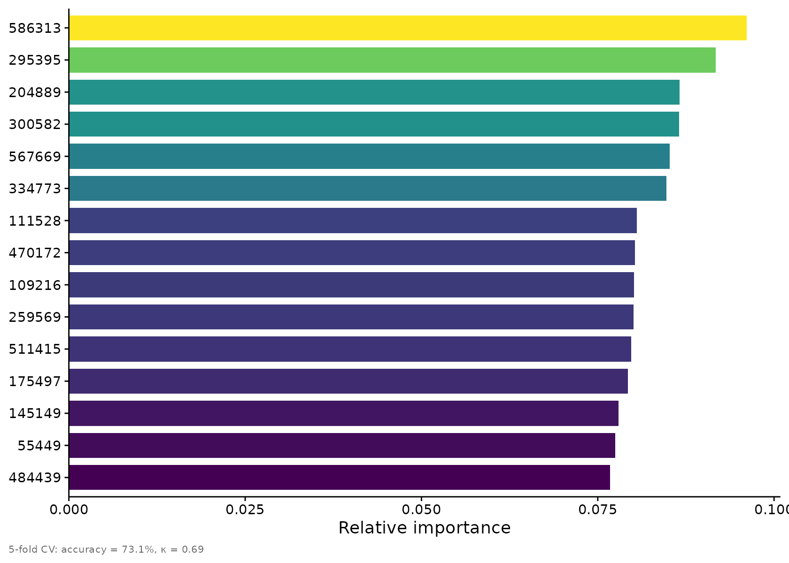

A two-class problem gives an ROC curve from out-of-fold predictions:

``` r

two <- phyloseq::subset_samples(gp_genus, SampleType %in% c("Feces", "Soil"))
mp_ml(two, group.by = "SampleType", plot.type = "roc", seed = 1)
```

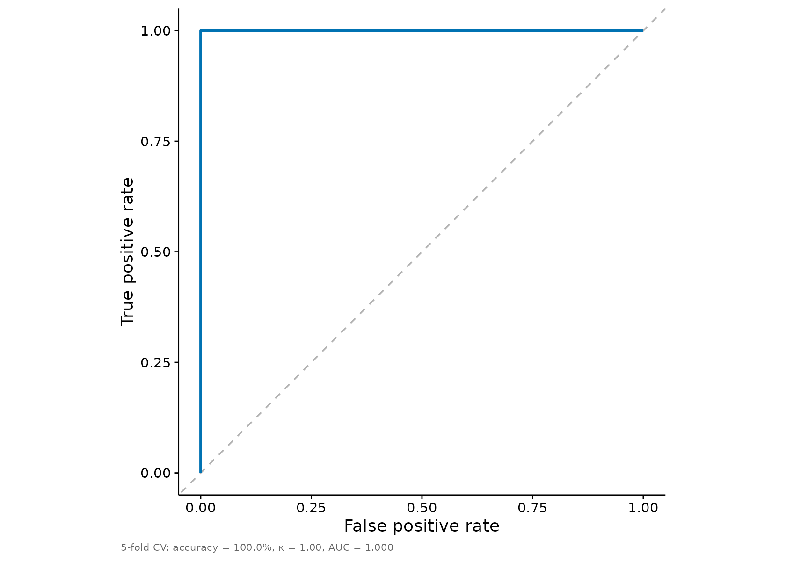

A numeric response switches to regression, scored by RMSE / R-squared:

``` r

mp_ml(gp_genus, group.by = "pH", method = "rf",
      plot.type = "prediction", seed = 1)
```

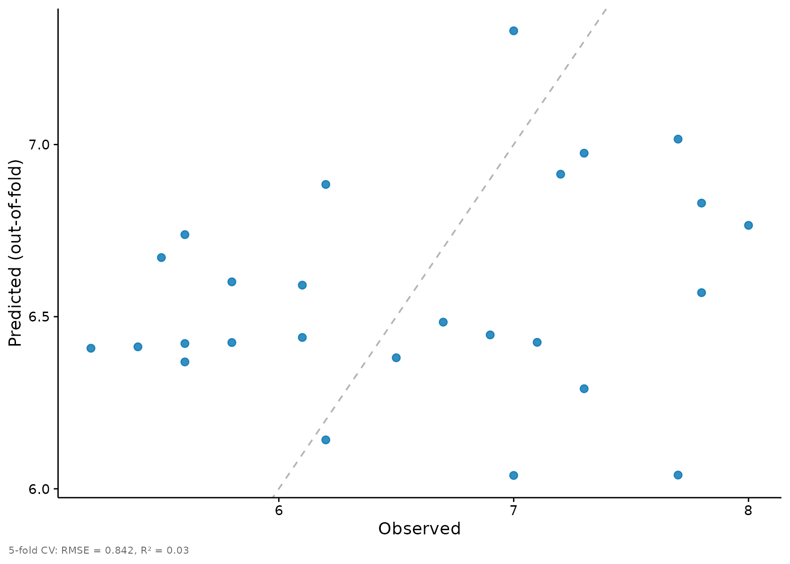

`return.data = TRUE` hands back the importance table with the fitted
model, cross-validation predictions and metrics attached as attributes:

``` r

imp <- mp_ml(gp_genus, group.by = "SampleType", return.data = TRUE, seed = 1)
head(imp, 3)
#>   feature importance
#> 1  586313 0.09609674
#> 2  295395 0.09173454
#> 3  204889 0.08663335
attr(imp, "metrics")$caption
#> [1] "5-fold CV: accuracy = 73.1%, κ = 0.69"
```

## Coverage plots

[`mp_coverage()`](https://daniilidisk.github.io/micropubr/reference/mp_coverage.md)
draws sequencing depth across a genome from a data frame,
`samtools depth`, bedGraph/BED files, or a BAM (via `Rsamtools`).

``` r

set.seed(1)
cov <- data.frame(
  contig = rep(c("contig1", "contig2"), each = 100),
  position = rep(seq(1, 10000, length.out = 100), 2),
  depth = c(rpois(100, 60), rpois(100, 25)))
mp_coverage(cov, format = "data.frame")
```

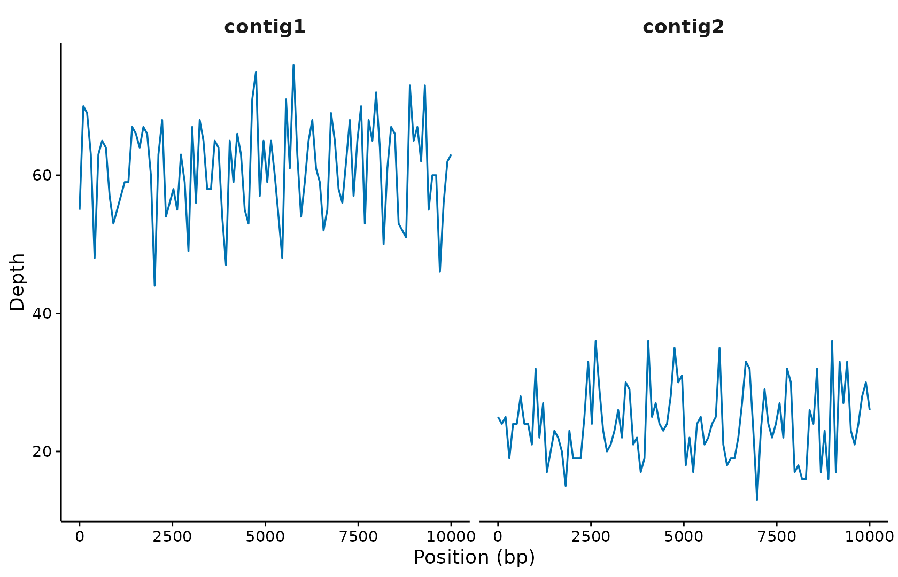

## Circular genome plots

[`mp_circos()`](https://daniilidisk.github.io/micropubr/reference/mp_circos.md)
assembles an ideogram with optional coverage, GC, heatmap and annotation
tracks plus weighted ribbon links. (Requires `circlize`.)

``` r

genome <- data.frame(contig = c("c1", "c2", "c3"),
                     length = c(8000, 5000, 3000))
covc <- do.call(rbind, lapply(genome$contig, function(ct) {
  L <- genome$length[genome$contig == ct]
  data.frame(contig = ct, position = seq(1, L, 50),
             value = runif(length(seq(1, L, 50)), 10, 90))
}))
links <- data.frame(contig1 = "c1", start1 = 500, end1 = 1500,
                    contig2 = "c2", start2 = 1000, end2 = 2000,
                    weight = 0.8)
mp_circos(genome, coverage = covc, links = links, link.by = "weight",
          coverage.type = "area")
```


## Chord diagrams

[`mp_chord()`](https://daniilidisk.github.io/micropubr/reference/mp_chord.md)
links the top taxa to the levels of a grouping variable, ribbon width
proportional to mean relative abundance. (Requires `circlize`.)

``` r

mp_chord(gp, group.by = "SampleType", tax.level = "Phylum", top.n = 10)
```

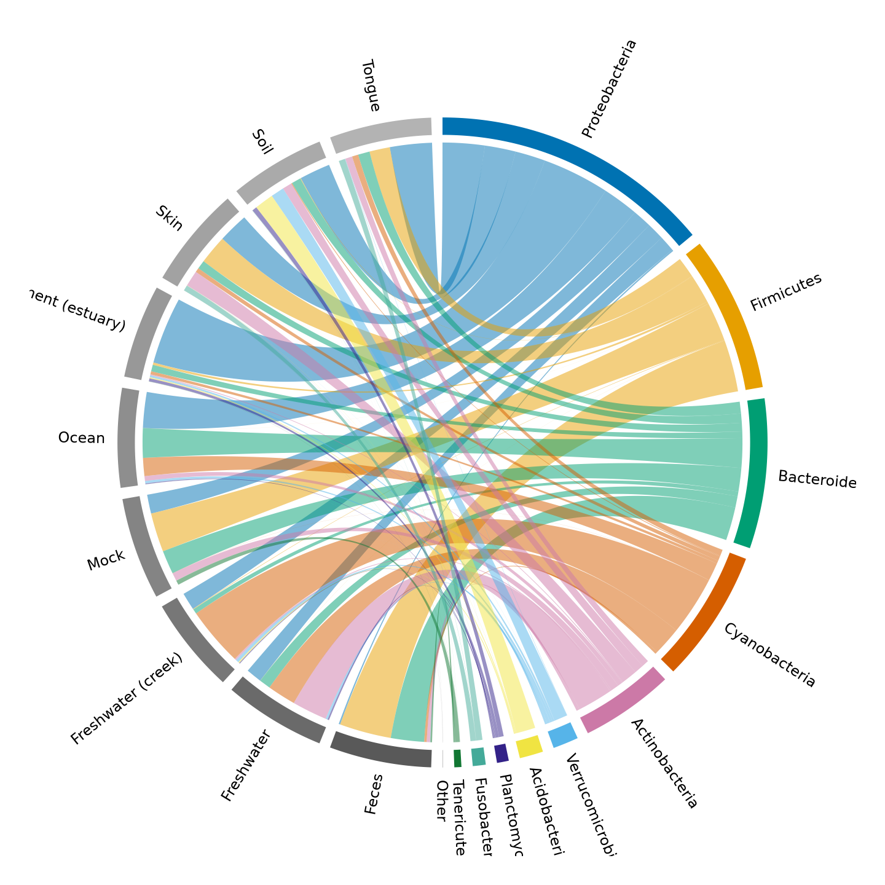
