# Visualization gallery

This vignette walks through every **plotting** function in `micropubr`.
Each returns a `ggplot2` object you can extend with `+`, share a common
set of arguments (`group.by`, `palette`, `theme`,
`plot.title`/`subtitle`/`caption`, `interactive`, `return.data`,
`verbose`) and forward extra `...` to their primary geom. For the
statistical, machine-learning and genomics functions see
[`vignette("stats-ml-genomics", package = "micropubr")`](https://daniilidisk.github.io/micropubr/articles/stats-ml-genomics.md).

> **Tip.** Pass `interactive = TRUE` to any plotting function to get a
> [`plotly`](https://plotly.com/r/) widget instead of a static figure —
> see the [Interactive figures](#interactive-figures) section below for
> live examples.

``` r

library(micropubr)
data(GlobalPatterns, package = "phyloseq")

# A lightly filtered subset keeps the examples fast.
gp <- phyloseq::prune_taxa(
  phyloseq::taxa_sums(GlobalPatterns) > 5, GlobalPatterns)
```

## Alpha diversity

[`mp_alpha()`](https://daniilidisk.github.io/micropubr/reference/mp_alpha.md)
computes within-sample diversity and, given a grouping variable, adds
the appropriate test automatically. x-axis labels rotate on their own
when groups are many or long, so they never overlap.

``` r

mp_alpha(gp, measure = c("Shannon", "Observed"),
         group.by = "SampleType", test = "kruskal")
```

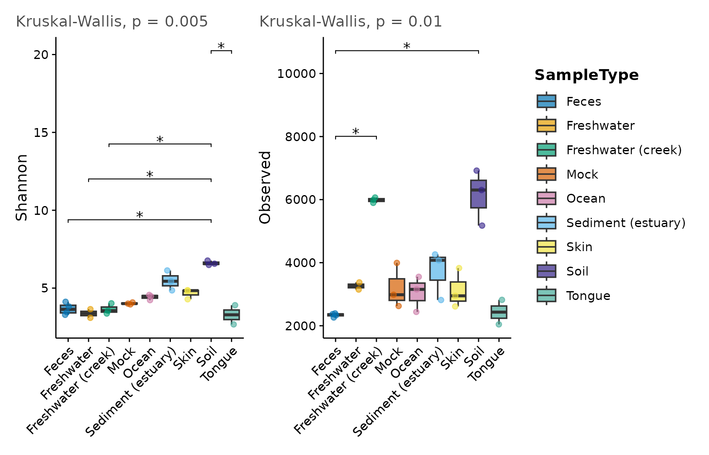

Switch the geometry with `plot.type` (`"box"`, `"violin"`, `"dot"`) or
draw rarefaction curves:

``` r

mp_alpha(gp, measure = "Shannon", group.by = "SampleType",
         plot.type = "violin")
```

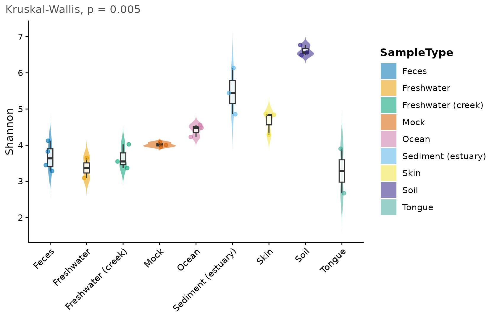

``` r

mp_alpha(gp, plot.type = "rarefaction", group.by = "SampleType")
```

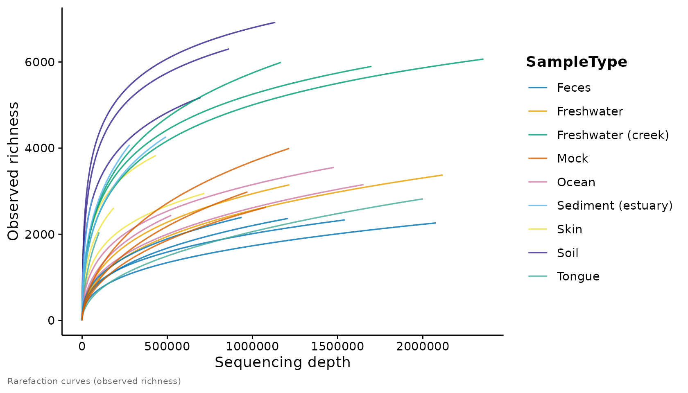

## Beta diversity and ordination

[`mp_ordination()`](https://daniilidisk.github.io/micropubr/reference/mp_ordination.md)
computes the distance, runs the ordination, draws group ellipses and
reports a PERMANOVA in the caption by default.

``` r

mp_ordination(gp, method = "PCoA", distance = "bray", group.by = "SampleType")
```


The compositional (Aitchison) PCA workflow is one argument away, and
`envfit` overlays metadata vectors:

``` r

mp_ordination(gp, method = "PCA", group.by = "SampleType")
```

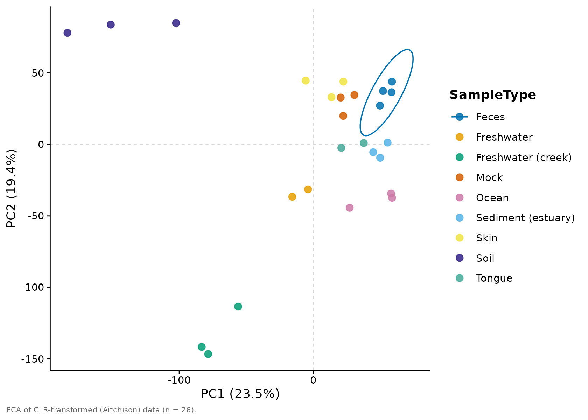

## Taxonomic composition

[`mp_taxa()`](https://daniilidisk.github.io/micropubr/reference/mp_taxa.md)
shows the top taxa at any rank and collapses the rest into “Other”. It
supports `"bar"`, `"area"`, `"heatmap"`, `"bubble"` and `"treemap"`
layouts.

``` r

mp_taxa(gp, tax.level = "Phylum", group.by = "SampleType", top.n = 8)
```

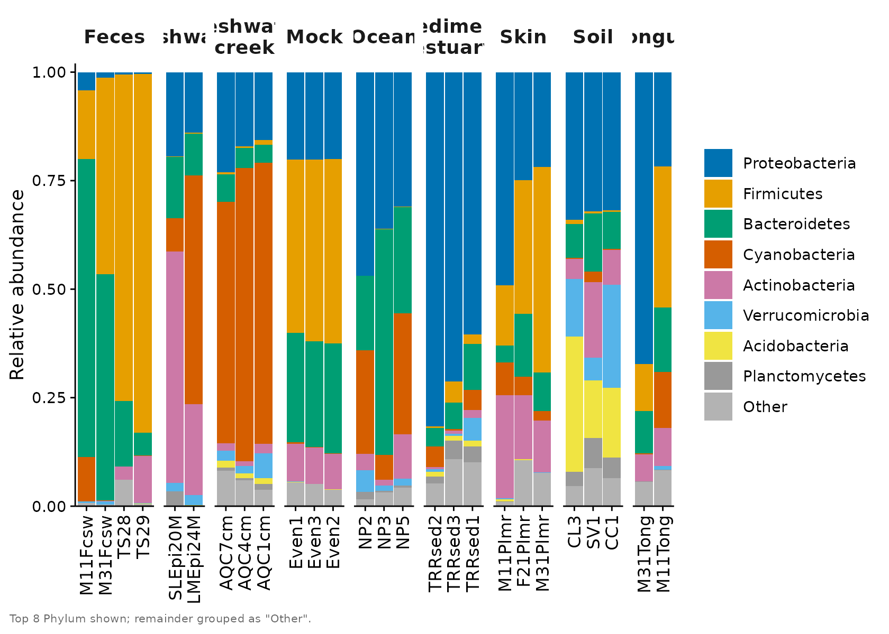

``` r

mp_taxa(gp, tax.level = "Phylum", plot.type = "heatmap", top.n = 10)
```

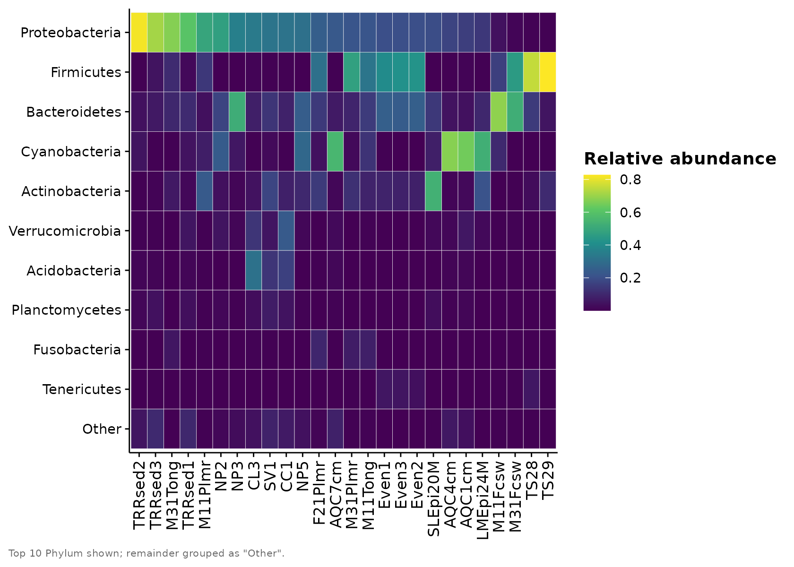

## Differential abundance

[`mp_diff()`](https://daniilidisk.github.io/micropubr/reference/mp_diff.md)
visualises results from `DESeq2`, `ALDEx2`, `ANCOM-BC` or any generic
table. Here is a volcano plot from a generic data frame:

``` r

set.seed(1)
res <- data.frame(
  feature = paste0("ASV", 1:200),
  log2FC  = rnorm(200, 0, 2),
  pvalue  = runif(200)^2
)
res$log2FC[1:20] <- rnorm(20, 4, 0.5) * sample(c(-1, 1), 20, TRUE)
res$pvalue[1:20] <- runif(20, 1e-9, 1e-4)
res$padj <- p.adjust(res$pvalue, "BH")

mp_diff(res, plot.type = "volcano", label.top = 8)
```

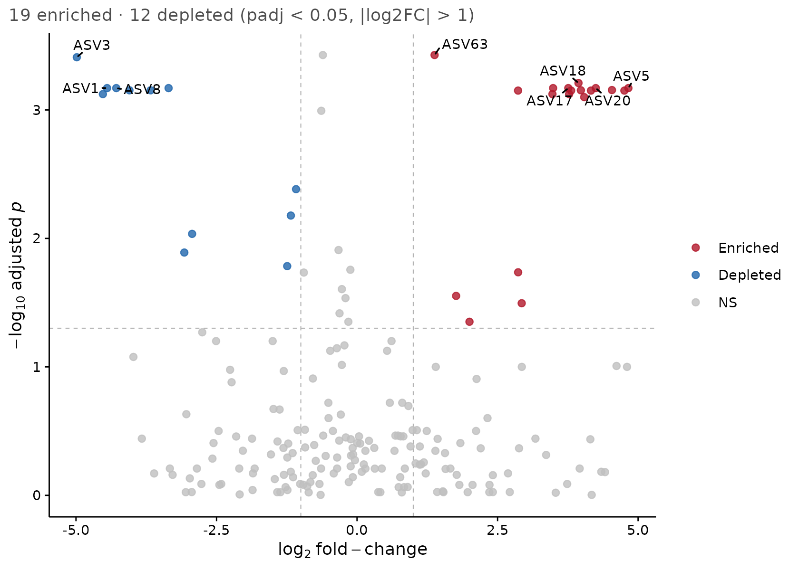

Other layouts include `"ma"`, `"forest"`, `"dot"` and `"concordance"`
(to compare two methods).

``` r

res$mean <- runif(200, 1, 500)
mp_diff(res, plot.type = "ma", label.top = 6)
```

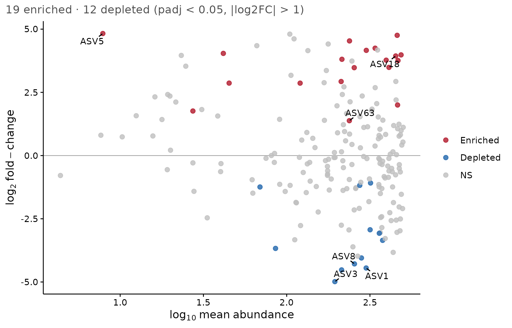

## Phylogenetic trees

[`mp_tree()`](https://daniilidisk.github.io/micropubr/reference/mp_tree.md)
renders the tree with `ggtree`, optionally colouring tips by taxonomy
and drawing an abundance ring. (Requires `ggtree`/`ggtreeExtra`.)

Agglomerating to a rank and keeping the most abundant tips (`top.n`)
keeps the tree and its colour legend legible:

``` r

gp_phy <- phyloseq::tax_glom(gp, "Phylum")
mp_tree(gp_phy, layout = "circular", color.by = "Phylum", top.n = 12)
```

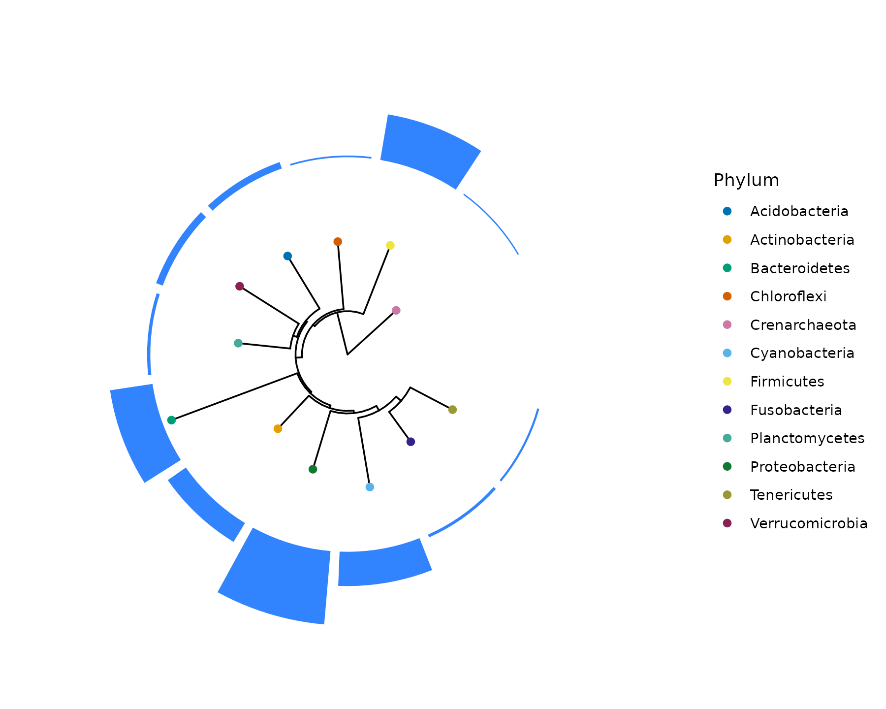

## Co-occurrence networks

[`mp_network()`](https://daniilidisk.github.io/micropubr/reference/mp_network.md)
builds a taxon co-occurrence network. (Requires `igraph`, `ggraph` and
`tidygraph`.)

``` r

mp_network(phyloseq::tax_glom(gp, "Genus"), tax.level = "Genus",
           top.n = 40, node.color.by = "Phylum")
```

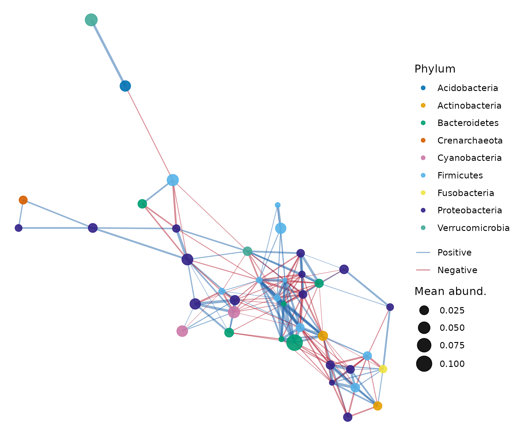

## Longitudinal dynamics

[`mp_longitudinal()`](https://daniilidisk.github.io/micropubr/reference/mp_longitudinal.md)
shows community change over time. We build a small synthetic time-series
object to demonstrate it.

``` r

set.seed(1)
n_taxa <- 12; subjects <- paste0("S", 1:4); days <- c(0, 7, 14, 28)
samples <- expand.grid(Subject = subjects, Day = days)
samples$id <- paste(samples$Subject, samples$Day, sep = "_")
otu <- matrix(rpois(n_taxa * nrow(samples), 50), nrow = n_taxa,
              dimnames = list(paste0("ASV", 1:n_taxa), samples$id))
tax <- matrix(paste0("Genus", rep(1:n_taxa)), ncol = 1,
              dimnames = list(rownames(otu), "Genus"))
ps_long <- phyloseq::phyloseq(
  phyloseq::otu_table(otu, taxa_are_rows = TRUE),
  phyloseq::tax_table(tax),
  phyloseq::sample_data(data.frame(samples, row.names = samples$id)))
```

``` r

mp_longitudinal(ps_long, time.var = "Day", subject.var = "Subject",
                measure = "Shannon", group.by = NULL)
```

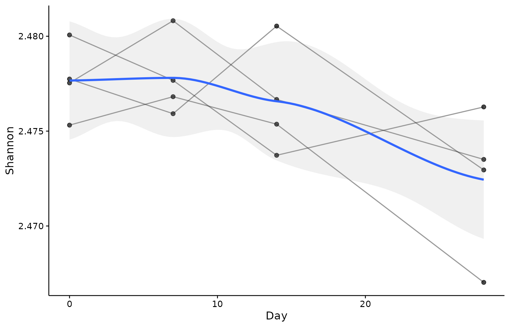

## Function / pathway abundance

[`mp_function()`](https://daniilidisk.github.io/micropubr/reference/mp_function.md)
plots a feature-by-sample functional table (e.g. PICRUSt2 or HUMAnN
output) as a heatmap, bar or bubble chart.

``` r

set.seed(2)
fn <- matrix(rlnorm(20 * ncol(otu), 3), nrow = 20,
             dimnames = list(paste0("K", sprintf("%05d", 1:20)),
                             colnames(otu)))
mp_function(fn, plot.type = "heatmap", top.n = 15)
```

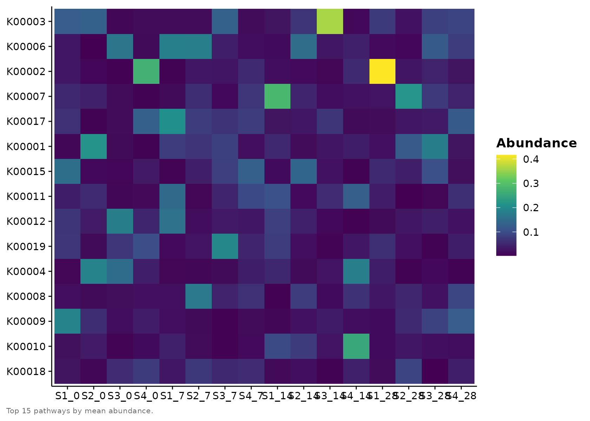

## Interactive figures

Every `mp_*()` plotting function takes `interactive = TRUE`, which
returns a [`plotly`](https://plotly.com/r/) widget instead of a static
`ggplot`. The figures below are **live**: hover for tooltips, drag to
zoom, double-click to reset, and click legend entries to toggle groups.
This requires the `plotly` package.

``` r

mp_alpha(gp, measure = "Shannon", group.by = "SampleType",
         test = "kruskal", interactive = TRUE)
```

The same flag works for ordinations — hover a point to read off its
sample and coordinates:

``` r

mp_ordination(gp, method = "PCoA", distance = "bray",
              group.by = "SampleType", interactive = TRUE)
```

…and for composition bars, where each segment reports its taxon and
relative abundance on hover. (For interactive bars we leave `group.by`
off: `plotly` crams faceted strip labels, so a single per-sample panel
reads more clearly.)

``` r

mp_taxa(gp, tax.level = "Phylum", top.n = 8, interactive = TRUE)
```

Multi-panel output (several measures, or
[`mp_combine()`](https://daniilidisk.github.io/micropubr/reference/mp_combine.md)
figures) is assembled into a single
[`plotly::subplot()`](https://rdrr.io/pkg/plotly/man/subplot.html):

``` r

mp_alpha(gp, measure = c("Shannon", "Observed"),
         group.by = "SampleType", interactive = TRUE)
```

Save any interactive figure as a self-contained HTML page with the same
[`mp_export()`](https://daniilidisk.github.io/micropubr/reference/mp_export.md)
you use for static ones (just give it an `.html` name):

``` r

w <- mp_ordination(gp, group.by = "SampleType", interactive = TRUE)
mp_export(w, "ordination.html")
```

A couple of caveats worth knowing. Static-only annotations such as the
significance brackets drawn by
[`mp_alpha()`](https://daniilidisk.github.io/micropubr/reference/mp_alpha.md)
are not reproduced by the conversion (the omnibus test still appears as
the subtitle). And the circular
[`mp_chord()`](https://daniilidisk.github.io/micropubr/reference/mp_chord.md)
/
[`mp_circos()`](https://daniilidisk.github.io/micropubr/reference/mp_circos.md)
figures are drawn with `circlize` rather than `ggplot2`, so they have no
interactive mode and ignore `interactive`.

## Theming and palettes

Every function accepts `theme` and `palette`. The defaults are
colourblind safe; swap them freely, or set them once with
[`mp_set_defaults()`](https://daniilidisk.github.io/micropubr/reference/mp_set_defaults.md).

``` r

mp_taxa(gp, tax.level = "Phylum", top.n = 6,
        palette = "taxa20", theme = mp_theme_nature())
```


``` r

mp_palettes()
#> $diverging
#> [1] "diverging"
#> 
#> $qualitative
#>  [1] "taxa10"  "taxa20"  "taxa40"  "okabe"   "groups2" "groups3" "groups4"
#>  [8] "groups5" "groups6" "groups7" "groups8"
#> 
#> $sequential
#> [1] "sequential" "viridis"
mp_palette("diverging", n = 7)
#> [1] "#2166AC" "#4F92C3" "#96C3DC" "#F7F7F7" "#F1AE93" "#DA644F" "#B2182B"
```

## Composing and exporting figures

Combine panels into a labelled multi-panel figure and export it at a
journal column width.

``` r

fig <- mp_combine(
  mp_alpha(gp, measure = "Shannon", group.by = "SampleType"),
  mp_ordination(gp, group.by = "SampleType", permanova = FALSE),
  ncol = 2, tag.levels = "A"
)
fig
```

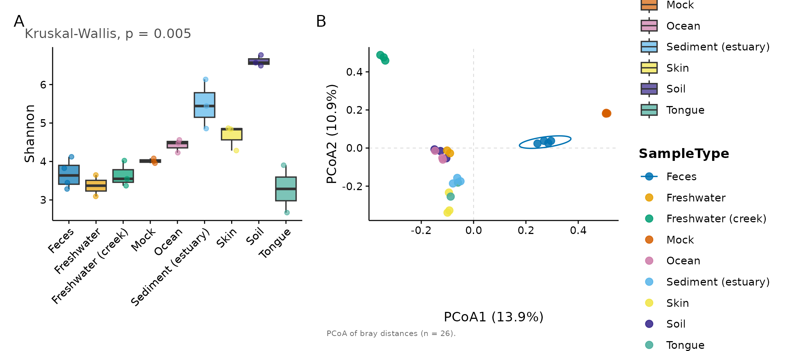

``` r

mp_export(fig, "figure1.pdf", column = "double", dpi = 600)
```
